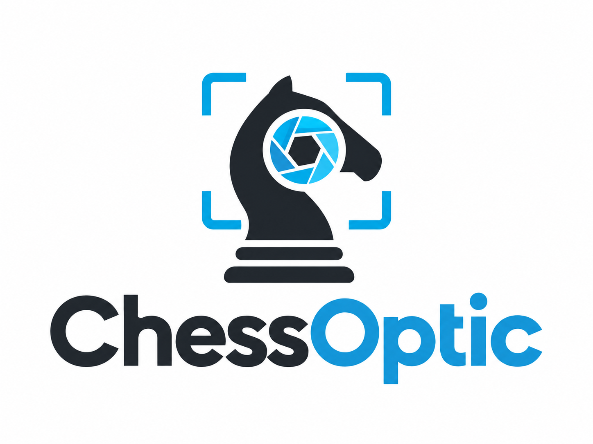

<p align="center">
  
</p>

# ChessOptic

**Jugá online en tu tablero de ajedrez de siempre.** ChessOptic convierte una webcam en el sensor de un tablero electrónico: detecta las jugadas que hacés con piezas reales y las lleva a la plataforma donde estás jugando.

> 🚧 Prueba de concepto en construcción. Todavía no hay versión usable. El plan completo está en [`docs/PLAN.md`](docs/PLAN.md).

## Cómo funciona

1. Ponés el tablero frente al monitor y apuntás la webcam.
2. ChessOptic calibra el tablero y sigue la partida casilla por casilla.
3. Tus jugadas se envían a la plataforma; las del rival las reproducís a mano y ChessOptic verifica que estén bien.
4. Un panel lateral angosto te muestra de reojo que todo funciona: cámara, detección, conexión y última jugada.

## Salidas previstas

- **Stockfish local**: para practicar sin internet.
- **Lichess**: vía la Board API oficial.
- **chess.com y otras plataformas**: vía [Chessconnect](https://chessconnect.de) (en investigación).

## Instalación

Todavía no hay versión publicada en PyPI. Desde el repo, con [uv](https://docs.astral.sh/uv/):

```bash
git clone https://github.com/sandyeveliz/chessoptic.git
cd chessoptic
uv sync                       # crea .venv e instala todo (Python 3.12 incluido)
uv run chessoptic doctor      # revisa cámara, Stockfish, dependencias y permisos
uv run chessoptic             # abre el panel lateral
```

Para instalarlo como herramienta global: `uv tool install .` (o `pipx install .`) y después `chessoptic`.

Windows, macOS y Linux. En Linux hacen falta las librerías de Qt (`libxcb-cursor0`, `libxkbcommon-x11-0`, `libegl1`…; ver `.github/workflows/ci.yml`). Los instaladores nativos llegarán con la v1 estable.

### Desarrollo

```bash
uv sync --all-groups
uv run ruff check . && uv run ruff format --check .
uv run mypy
```

Estado y orden de trabajo: [`docs/IMPLEMENTATION.md`](docs/IMPLEMENTATION.md).

## Contribuir

Ideas, issues y PRs son bienvenidos. Leé [`docs/PLAN.md`](docs/PLAN.md) para entender las decisiones de diseño.

## Licencia

[Apache-2.0](LICENSE)
