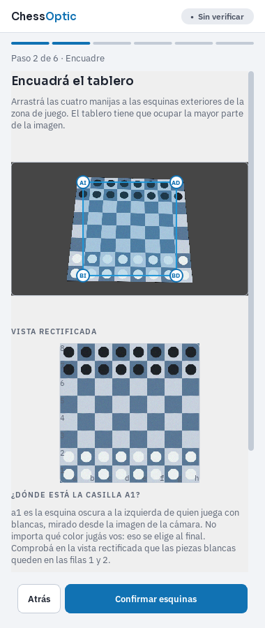
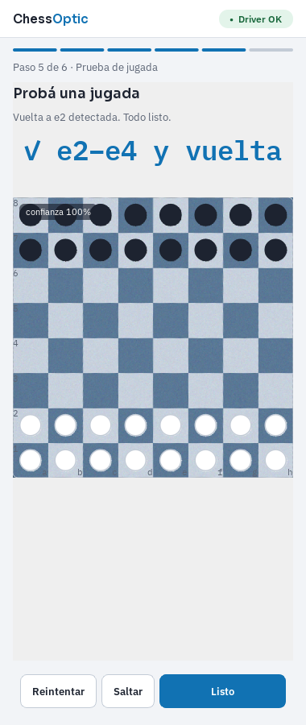
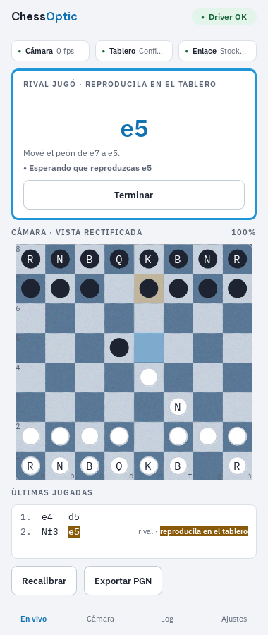
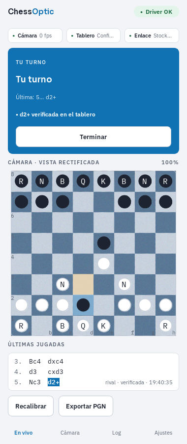

<p align="center">
  
</p>

# ChessOptic

**Jugá en tu tablero de ajedrez de siempre, con una webcam común.** ChessOptic convierte la cámara en el sensor de un tablero electrónico: detecta las jugadas que hacés con piezas reales, las valida y las entrega a un motor local o, más adelante, a una plataforma online. Las jugadas del rival te las muestra en grande y verifica que las reproduzcas bien.

> **v0.1.0** — prueba de concepto cerrada: se juega una partida completa contra Stockfish moviendo solo las piezas. Open source (Apache-2.0), Windows / macOS / Linux. Lo que sigue: [`docs/ROADMAP.md`](docs/ROADMAP.md).

<p align="center">
  
  
  
  
</p>

<sub>Capturas con un tablero sintético (el que usa la verificación sin cámara). Con una cámara real se ve tu tablero.</sub>

## Qué hace hoy

- **Cualquier cámara, cualquier ángulo.** Un asistente de 6 pasos calibra el tablero (arrastrás las cuatro esquinas), aprende cómo se ven *tus* piezas con la posición inicial, chequea que las detecta y te hace probar una jugada antes de empezar. Nada que descargar ni entrenar.
- **Reconoce las jugadas** por lo que cambia en la imagen: normales, capturas, enroque, al paso y promoción. Tolera sombras y manos; una jugada se acepta recién cuando el tablero queda quieto y la ve dos veces.
- **Dos proveedores**: *Solo seguimiento* (anota la partida de los dos bandos y exporta el PGN) y *Stockfish local* (cualquier motor UCI, nivel 1–8, elegís color).
- **Un panel lateral angosto** que se lee de reojo: cámara con la posición superpuesta, estado de la partida y de la detección ("levantaste el peón de e2", "vi e4, confirmando…"), últimas jugadas con la del rival pendiente, salud de cámara / tablero / enlace.
- Si algo se lee mal, **tocás la casilla** y aprende. Y sigue aprendiendo con cada jugada aceptada.

## Instalación

Hace falta [uv](https://docs.astral.sh/uv/) (instala el Python que corresponde). Para jugar contra el motor, [Stockfish](https://stockfishchess.org/download/) en el PATH o la ruta del ejecutable en Ajustes.

```bash
git clone https://github.com/sandyeveliz/chessoptic.git
cd chessoptic
uv sync                       # crea .venv e instala todo
uv run chessoptic doctor      # revisa cámara, Stockfish y dependencias
uv run chessoptic             # abre el panel y el asistente
```

Como herramienta global: `uv tool install .` y después `chessoptic`.

En Linux hacen falta las librerías de Qt (`libxcb-cursor0`, `libxkbcommon-x11-0`, `libegl1`…; ver [`.github/workflows/ci.yml`](.github/workflows/ci.yml)).

## Primer uso

Guía de cámara, luz y de cada paso del asistente: [`docs/SETUP.md`](docs/SETUP.md). En dos líneas: tablero entero en la imagen ocupando lo más posible, cámara fija, luz pareja. Desde arriba es lo más fácil; en diagonal funciona si la fila más lejana no queda cortada en el borde.

## Cómo está hecho

Python 3.12, OpenCV, python-chess, PySide6. El núcleo no depende de Qt y toda la visión funciona sin cámara (fuentes de frames inyectables), así que se verifica con un tablero sintético.

- [`docs/PLAN.md`](docs/PLAN.md): qué es, decisiones y etapas.
- [`docs/IMPLEMENTATION.md`](docs/IMPLEMENTATION.md): arquitectura, hitos y cómo se probó cada parte.
- [`docs/STATES.md`](docs/STATES.md): estados de la partida y de la detección, con sus reglas.
- [`docs/EXTENDING.md`](docs/EXTENDING.md): cómo agregar proveedores, motores, cámaras y modos de juego.
- [`CHANGELOG.md`](CHANGELOG.md).

### Desarrollo

```bash
uv sync --all-groups
uv run ruff check . && uv run ruff format --check .
uv run mypy
```

Sin tests automáticos todavía (decisión de la fase POC, ver `CLAUDE.md`); lint y tipos estrictos corren en CI en los tres sistemas.

## Contribuir

Ideas, issues y PRs son bienvenidos. Si tenés un tablero y una cámara distintos, lo más útil es contar cómo te fue con el asistente y, si algo se lee mal, los archivos que ChessOptic deja en la carpeta `debug` de sus datos.

## Licencia

[Apache-2.0](LICENSE). Fuentes Sora e IBM Plex bajo [SIL Open Font License](src/chessoptic/assets/fonts/).
